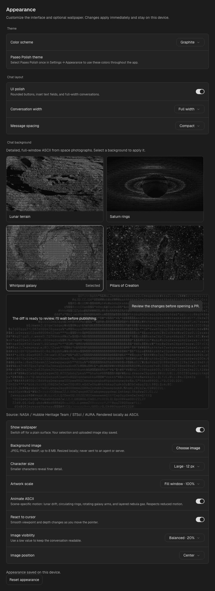

# Paseo Polish

A Paseo plugin with a Hoplite-inspired interface, Geist typography, rounded controls, three color schemes, custom chat images, and interactive space ASCII backgrounds.



## Install

Requires Paseo 0.17.1 or newer. Install from GitHub:

```sh
paseo plugin add git:jdharcourt/paseo-polish
```

Enable plugins in Settings → Plugins. Plugins are trusted, unsandboxed code. Open **Paseo Polish** in the sidebar or use `/appearance`. Select **Paseo Polish** once under Settings → Appearance, then switch Graphite, Charcoal, or Paper in the plugin menu.

## Backgrounds

Choose Lunar terrain, Saturn rings, Whirlpool galaxy, or Pillars of Creation. Each is drawn from bundled NASA photograph luminance, covers the full chat pane, and remains crisp when resized. Ten additional procedural ASCII scenes include rings, discs, flowing ribbons, interference waves, terrain, a vortex, a tunnel, and character rain, inspired by the [Devault library](https://devault.design/ascii-art-generator/library/). These generate live luminance fields and use the same cursor physics as the space images; they do not play pre-rendered images or videos. Selecting a preset enables animation and interaction; both can be disabled independently. Backgrounds also appear in the empty workspace composer before a chat begins.

- **Character size:** 4–20 px, from fine detail to large visible glyphs.
- **Artwork scale:** fill the pane, or zoom to 125%, 150%, or 200% independently of character size.
- **Animate ASCII:** steady lunar camera drift, circulating Saturn ring detail, differential galaxy rotation, and layered nebula gas.
- **React to cursor:** local ASCII displacement around the pointer. Choose **Push away** or **Pull in**, **Gentle / Normal / Strong** strength, **Off / Short / Medium / Long** trails, and **Off / Soft / Springy** bounce. Controls apply immediately, stay on this device, and work independently of scene animation.
- **Image visibility** and **Image position:** adjust strength and vertical crop.

Animation pauses for hidden or offscreen panes. Motion and cursor displacement respect the system's reduced-motion preference. Wallpaper canvases do not intercept clicks, typing, selection, or scrolling. Effects start off and apply to the built-in ASCII presets. Scene-specific motion uses a local WebGL glyph renderer, preserving upright characters as the scene changes. Browsers without WebGL retain the detailed 2D artwork with gentle camera motion.

You can also upload a JPEG, PNG, or WebP up to 8 MB and 40 megapixels. Custom images retain their photographic appearance. File signatures and MIME types are checked before decoding; images are resized to at most 4096 pixels and re-encoded locally as JPEG. Changing presets keeps your uploaded image saved. **Show wallpaper** switches to a plain surface without deleting it.

Images and preferences stay in this app or browser's local storage and do not sync between devices. They are not sent to the daemon, an agent, or an image service. Other trusted code running in the same app can access that storage. Checkout inspection runs on the daemon using Git and the authenticated GitHub CLI.

Cursor interaction is inspired by [Insomnia](https://getinsomnia.app/). Motion studies include [ASCII Magic’s Cosmos collection](https://www.ascii-magic.com/ascii/category/cosmos) and [Astro ASCII](https://github.com/kenny2077/astro-ascii). The effects are artistic, time-compressed interpretations of space imagery, rather than astronomical simulations.

## Interface

Buttons and tabs use Hoplite's 10-pixel control radius, with rounded command/output containers, inset text fields, full-width left-aligned conversations, and a 248-pixel desktop sidebar. **UI polish** restores the standard layout while retaining preferences when switched off. **Reset appearance** restores defaults and deletes the uploaded image. Removing the plugin removes its styling; device-local preferences remain until reset or site storage is cleared.

Geist and Geist Mono are bundled under the [SIL Open Font License](client/Geist-OFL.txt). Space-image credits and 4K/text exports are in [assets/space](assets/space/README.md).

Layout, images, and ASCII animation work in desktop and mobile browsers, including phone-sized layouts. Phone and touch layouts use 44-pixel controls and 16-pixel input text. Choose a background separately in each browser; appearance does not sync between devices.

Native iOS and Android support Graphite, Charcoal, and Paper through Settings → Appearance: choose **Paseo Polish** (Graphite), **Paseo Polish · Charcoal**, or **Paseo Polish · Paper**. The native app saves this choice. Native chat wallpapers and global button/layout styling are not exposed by the current plugin API; the plugin links to the mobile web app for the full appearance. Native device rendering has not been verified on hardware. Styling targets internal Paseo selectors verified against 0.17.1; later versions may require updates.

## Development

```sh
git clone https://github.com/jdharcourt/paseo-polish.git
cd paseo-polish
npm ci
npm run typecheck
npm test
paseo plugin install "$PWD"
```

After editing, run the checks and `paseo plugin reload polish`. `npm run backgrounds` regenerates the bundled luminance, thumbnails, 3840 × 2160 wallpapers, text exports, and contact sheet. It uses the system Menlo font on macOS, or the bundled Geist Mono elsewhere, and downloads missing source photographs from NASA over HTTPS. Development source-photo caches are ignored by Git. Run `node scripts/generate-ascii-scenes.mjs` to regenerate procedural scene thumbnails from their live generators.

## Changes and pull requests

Polish adds separate Changes and Pull request tabs to the Explorer. On wide layouts, the PR window opens automatically when GitHub reports a verified PR for the active task checkout. It follows new PR identities without repeatedly stealing focus; the header button reopens a manually closed window. Compact clients use that button.

The PR window follows Paseo’s built-in PR layout: View and Refresh controls, title and state, repository, check summary, filterable check rows with workflow names and durations, and expandable comment and review activity. Add to chat inserts quoted external content into the focused composer only when clicked; it never sends a prompt or posts a GitHub comment. Approval counts include the latest meaningful review per author on the accepted PR head. This is a plugin-owned window using public SDK registrations; it does not modify Paseo’s app source or depend on internal DOM selectors.

Checkout inspection runs every three seconds; GitHub discovery is cached for ten seconds and open PR details refresh every fifteen seconds. Manual Refresh bypasses discovery caching. A changed head hides stale check and activity results until identity catches up. Missing authentication, unavailable checks, and preview limits are shown explicitly.

New registered task worktrees automatically become their parent chat’s checkout target through plugin-owned metadata. Existing chats with one registered task worktree in the same project follow it. An explicit target must be a registered direct child; unrelated targets are rejected. Git refs and agent placement are unchanged. PR discovery verifies the head repository and branch. Merged PR diffs remain available; local modifications and untracked files appear separately in Changes.

The daemon requires Git and authenticated `gh` on its PATH. Only GitHub PRs are supported. Diff previews are limited to 200,000 characters per section; untracked previews include up to 100 regular files with a 32 KB limit per file. PR details show up to 500 checks and the latest 100 activity records with 20,000 characters per body; Add all to chat is limited to 32,000 characters. Truncation is reported. The daemon sends checkout contents to connected plugin clients, and does not upload local changes to GitHub or send them to an agent automatically.

The plugin uses shared, theme-aware controls adapted from [Notra UI](https://ui.usenotra.com/) patterns for React Native: compact ghost buttons, underline check filters, and collapsible activity rows with one-line previews. PR comments start collapsed beneath CI; expand a row to read Markdown and add it to chat. Settings retain Paseo’s native select and switch controls because the plugin host does not support Notra’s DOM/Tailwind dependencies.

The PR window distinguishes draft, open, merged, closed, and queued pull requests. While queued, it polls every 15 seconds and separates PR checks from the merge queue commit’s checks, showing queue position and state. Expand a check for its reported conclusion, failed steps, summary, and annotations, or open the complete CI output on GitHub. Queue API failures are shown explicitly; an unavailable queue commit never inherits passing PR checks.
